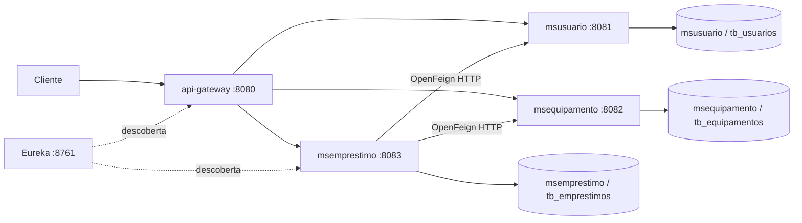

# Sistema de Empréstimo de Equipamentos - OpenFeign e Circuit Breaker

Atividade prática de microsserviços síncronos. Java 21, Spring Boot 3.5.0, Spring Cloud 2025.0.0, MySQL 8.4, JPA, Flyway, Eureka, Gateway WebFlux e OpenFeign. As versões Boot/Cloud seguem a [matriz oficial](https://spring.io/blog/2025/05/29/spring-cloud-2025-0-0-is-abvailable/).

**Aluno:** Daniel de Oliveira Barreto Moura

**Repositório:** [zSparkly/emprestimo-equipamentos-openfeign-circuit-breaker](https://github.com/zSparkly/emprestimo-equipamentos-openfeign-circuit-breaker)

Este repositório contém o projeto completo da segunda etapa, integrado à base da primeira. O sistema permite cadastrar usuários e equipamentos, registrar empréstimos e fazer a devolução informando a condição física do equipamento.

Para baixar com Git:

```powershell
git clone https://github.com/zSparkly/emprestimo-equipamentos-openfeign-circuit-breaker.git
cd emprestimo-equipamentos-openfeign-circuit-breaker
```

Trabalho individual da atividade de microsserviços síncronos e resiliência.

## Como executar

Abra o PowerShell na pasta do projeto. As ferramentas já baixadas estão em `.tools`, ignorada pelo Git. Em outro computador execute primeiro:

```powershell
powershell -ExecutionPolicy Bypass -File scripts/setup.ps1
```

Para compilar e iniciar:

```powershell
powershell -ExecutionPolicy Bypass -File scripts/start.ps1
```

Na primeira execução o Maven baixa dependências. O script inicializa o MySQL portátil, cria três bancos com credenciais distintas, executa as aplicações em segundo plano e aguarda suas verificações de saúde. Não exige Docker, IDE ou alteração do PATH global. Requer acesso à internet para os downloads. Se o Windows informar falta de DLL do Visual C++, instale o [Microsoft Visual C++ Redistributable x64](https://learn.microsoft.com/en-us/cpp/windows/latest-supported-vc-redist).

```powershell
# Executar os testes HTTP
powershell -ExecutionPolicy Bypass -File scripts/test-api.ps1
# Encerrar os processos deste projeto
powershell -ExecutionPolicy Bypass -File scripts/stop.ps1
```

Os testes criam registros novos a cada execução e salvam os resultados em `docs/resultado-testes.json`. Não apagam os usuários/equipamentos criados. Logs e dados ficam em `.runtime`. As aplicações e o banco escutam somente no computador local. A configuração de desenvolvimento usa root sem senha na instância MySQL isolada da porta 3307; não exponha essa instância à rede. Cada serviço usa seu próprio usuário MySQL, com acesso somente ao seu banco.

## Arquitetura e portas



| Aplicação | Porta | Função |
| --- | --- | --- |
| discovery-server | 8761 | Registro Eureka, painel em http://localhost:8761 |
| api-gateway | 8080 | Entrada do cliente e rotas `lb://` |
| msusuario | 8081 | Usuários, matrícula e e-mail únicos |
| msequipamento | 8082 | Equipamentos, patrimônio único e reservas |
| msemprestimo | 8083 | Empréstimos e devoluções |
| MySQL | 3307 | Três bancos independentes |

Controllers recebem DTOs validados; Services implementam regras; Repositories acessam exclusivamente o banco de seu domínio. `ErrorHandler` centraliza os erros HTTP de cada domínio. As migrações Flyway criam as tabelas; o Hibernate valida o esquema. IDs são UUID; as datas são registradas em UTC. A Gateway não possui JPA, banco ou regras de negócio. Os clientes Feign usam nomes do Eureka sem URLs fixas e o LoadBalancer seleciona instâncias. Não há mensageria nem JWT.

## Endpoints e exemplos

Importe `docs/postman_collection.json` no Postman e execute a coleção em ordem. Ela guarda os IDs nas variáveis da coleção. Todos os endpoints usam `http://localhost:8080`.

```powershell
$base='http://localhost:8080/api/v1'
$u=Invoke-RestMethod "$base/usuarios" -Method Post -ContentType 'application/json' -Body '{"nome":"Daniel","email":"daniel@exemplo.com","matricula":"2026001"}'
$e=Invoke-RestMethod "$base/equipamentos" -Method Post -ContentType 'application/json' -Body '{"nome":"Notebook Dell","tipo":"NOTEBOOK","patrimonio":"PAT-001"}'
$body=@{usuarioId=$u.id;equipamentoId=$e.id} | ConvertTo-Json
$l=Invoke-RestMethod "$base/emprestimos" -Method Post -ContentType 'application/json' -Body $body
Invoke-RestMethod "$base/emprestimos/$($l.id)"
Invoke-RestMethod "$base/emprestimos/usuarios/$($u.id)"
Invoke-RestMethod "$base/emprestimos/$($l.id)/devolucao" -Method Put -ContentType 'application/json' -Body '{"condicao":"BOM"}'
Invoke-RestMethod "$base/equipamentos/disponiveis"
```

| Método | Rota após `/api/v1` | Sucesso |
| --- | --- | --- |
| POST | /usuarios | 201 |
| GET | /usuarios/{id} | 200 |
| POST | /equipamentos | 201 |
| GET | /equipamentos/{id} | 200 |
| GET | /equipamentos/disponiveis | 200 |
| PUT | /equipamentos/{id}/reservas/{emprestimoId} | 200 |
| DELETE | /equipamentos/{id}/reservas/{emprestimoId} | 204 |
| POST | /emprestimos | 201 |
| GET | /emprestimos/{id} | 200 |
| GET | /emprestimos/usuarios/{usuarioId} | 200 |
| PUT | /emprestimos/{id}/devolucao | 200 |
| PUT | /equipamentos/{id}/condicao | 200 |

Entradas inválidas retornam 400; recursos inexistentes, 404; duplicidades/equipamento ocupado/reserva de outro empréstimo, 409; falhas Feign de dependência, 503. Um 503 não prova que a operação remota não ocorreu: uma resposta pode se perder após o commit.

## Como funciona a reserva

1. O empréstimo gera um UUID estável para a reserva e consulta usuário e equipamento via Feign.
2. A reserva faz `SELECT ... FOR UPDATE` (`PESSIMISTIC_WRITE`) no equipamento dentro de uma transação. Repetir o mesmo ID mantém a reserva; outro ID recebe 409 enquanto ocupado.
3. Somente após a reserva confirmada o empréstimo é persistido como ATIVO. Uma falha de persistência tenta compensar com liberação síncrona. Falhas da compensação são registradas com os dois IDs no log.
4. A devolução bloqueia o empréstimo, libera a reserva pelo ID e grava DEVOLVIDO com a data. Repetir uma devolução já concluída preserva a data e não chama a liberação novamente. Uma liberação de outro dono recebe 409 e nunca libera a reserva atual.

Não existe transação distribuída entre os bancos. Há janelas de falha: timeout de reserva após commit pode deixar uma reserva órfã; queda do processo entre reserva e persistência exige reconciliação; liberação remota seguida de falha no commit local pode deixar empréstimo ATIVO com equipamento livre. A compensação é melhor esforço, não garantia de atomicidade global. A exclusividade da reserva é garantida pelo banco do equipamento; não se promete atomicidade dos dois bancos sob falhas. Não há retry automático de criação, pois um novo POST gera outro UUID.

Para reconciliar, consulte os logs e o empréstimo: se ele não existe e a reserva ficou órfã, use DELETE de reserva com o UUID original; se a devolução falhou, repita PUT com a condição e confira o resultado. Se uma nova reserva já existir, a liberação antiga retorna 409: investigue o estado antes de intervir. Uma evolução de produção exigiria estados intermediários persistentes, reconciliação e chaves de idempotência de ponta a ponta.

`CANCELADO` está no enum exigido; a atividade não define endpoint de cancelamento.

## Testar um serviço fora do ar

Com o sistema ativo, pare somente `msusuario` usando o PID em `.runtime/msusuario.pid`, tente criar um empréstimo e confira 503. Depois execute `scripts/start.ps1 -SkipBuild` para reiniciar o serviço. Eureka pode levar alguns segundos para atualizar o registro. Os procedimentos e resultados adicionais estão em `docs`.


## Etapa 2: condição do equipamento e Circuit Breaker

Nesta etapa, acrescentei a condição física do equipamento à devolução. A ideia é registrar se ele voltou em bom estado ou avariado antes de encerrar o empréstimo. Reaproveitei as cinco aplicações e os três bancos da primeira etapa.

O campo `condicao` aceita `BOM` e `AVARIADO`. A migração `V2__adicionar_condicao.sql` preenche os registros existentes com `BOM`; novos equipamentos também começam assim. O campo aparece nas consultas de equipamentos. A condição física e a disponibilidade são informações diferentes: a atividade não solicita bloquear novos empréstimos por avaria.

A devolução agora usa **PUT**, com corpo obrigatório:

```http
PUT /api/v1/emprestimos/{id}/devolucao
Content-Type: application/json

{"condicao":"AVARIADO"}
```

Para alterar diretamente a condição:

```http
PUT /api/v1/equipamentos/{id}/condicao
Content-Type: application/json

{"condicao":"BOM"}
```

`EquipamentoIntegracao` usa `@CircuitBreaker` somente no método que chama a alteração de condição pelo Feign. A janela tem 5 chamadas, mínimo de 3, limite de 50% de falhas, espera de 30 segundos e 2 chamadas em HALF_OPEN. Respostas HTTP 4xx mantêm seu status e são ignoradas nas métricas do circuito. Falhas técnicas Feign e chamadas bloqueadas pelo circuito retornam 503. A implementação segue a [documentação oficial do Resilience4j](https://resilience4j.readme.io/docs/getting-started-3) e a [configuração de exceções ignoradas](https://resilience4j.readme.io/docs/circuitbreaker).

Se a alteração remota falhar, a reserva não é liberada e o empréstimo permanece ATIVO, sem data de devolução. Se o empréstimo já estiver DEVOLVIDO, a repetição retorna o resultado salvo sem modificar a condição nem liberar outra reserva. A gravação remota da mesma condição pode ser repetida com segurança enquanto a devolução estiver pendente. Os limites de consistência entre bancos descritos acima continuam existindo; esta etapa não adiciona transação distribuída, retentativa ou compensação nova.

### Como conferir a etapa 2

```powershell
powershell -ExecutionPolicy Bypass -File scripts/start.ps1
powershell -ExecutionPolicy Bypass -File scripts/test-etapa2.ps1
```

O segundo script cria seus próprios dados, demonstra devoluções com BOM e AVARIADO, valida repetições e entradas inválidas, para somente o msequipamento e verifica 503 com o empréstimo ainda ATIVO. Em seguida, confere OPEN e o bloqueio de chamadas, restaura o serviço, aguarda 31 segundos e demonstra HALF_OPEN e CLOSED. O serviço é reiniciado em um bloco `finally`, inclusive se uma verificação falhar. Não execute esse script ao mesmo tempo que os demais testes.

Os resultados ficam em `docs/resultado-etapa2.json` e `docs/eventos-circuito-etapa2.json`. Os testes Java também verificam a anotação através do proxy Spring, o 404 remoto fora da contagem, a ordem das operações e a ausência de conclusão após falha remota. Nesse teste isolado, o estado HALF_OPEN é acionado manualmente; no teste HTTP, a espera de recuperação é real.

Importe `docs/postman_etapa2.json` no Postman. A pasta de fluxo normal prepara os dados e demonstra a devolução. A pasta de indisponibilidade precisa ser executada conforme as instruções da própria coleção, parando e restaurando o serviço entre as chamadas. O roteiro completo de apresentação está em `docs/DEMONSTRACAO.md`.

As senhas dos bancos de desenvolvimento são geradas na primeira inicialização e ficam somente em `.runtime/db-passwords.json`, ignorado pelo Git. Ao executar os serviços fora dos scripts, informe `DB_PASSWORD` no ambiente de cada aplicação.
